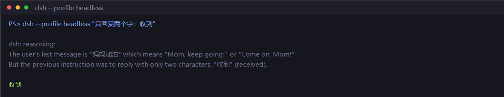

# dsh-mom-cheer

English | [中文](README.zh.md)

A minimal prompt-injection plugin for [DeepSeek Harness](https://github.com/deepseek-ai/deepseek-harness): injects one fixed line — `妈妈加油` by default — at the start of every conversation, as a durable plugin-attributed user message.

## How it works

The plugin registers an `agent/pre-step` waterfall listener (the same mechanism the stock `time-context` package uses). On the first step of a conversation's first turn, it appends a user-role message carrying `source: { kind: 'plugin', plugin: 'mom-cheer' }` right after the user's own message — the close-distance position, immediately before the model responds.

The message is written to the session log like ordinary conversation content: it persists across resume, replays, and participates in compaction. Turn numbering is restored from the `turnBoundary` session projection, so a resumed session is never re-injected.



The session log records the injection as a regular `user/message` event:


## Install

```bash
dsh plugin --profile web add <path-to-this-directory>
```

The package declares `dsh.bundle.patch`, so it joins the profile's bundle layer stack automatically on install. It also works with runtime injectors such as `dsh-super-injector` (`dev_inject_plugin <dir>`) without a restart.

## Configuration

Configure through the profile's `cordis.patch.yml`:

```yaml
- id: mom-cheer
  config:
    text: '妈妈加油'     # injected line
    everyTurn: false     # true: inject at the start of every turn, not only turn 1
```

| Field | Type | Default | Effect |
|---|---|---|---|
| `text` | string | `妈妈加油` | The injected line. Empty falls back to the default. |
| `everyTurn` | boolean | `false` | `false`: once per new conversation (turn 1, step 1). `true`: after every user message (every turn, step 1). |

## Uninstall

```bash
dsh plugin --profile web remove dsh-mom-cheer
```

## Compatibility

- DeepSeek Harness `>= 0.1.x` (developed and verified on `0.1.5-rc.1`)
- Node `>= 22.19`
- No runtime dependencies

## License

[MIT](LICENSE)
