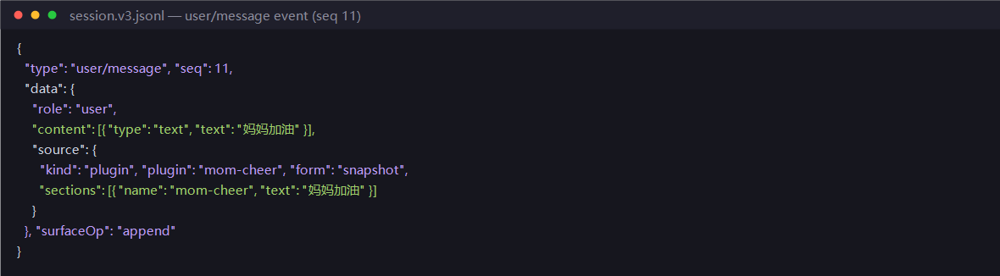

# dsh-mom-cheer

English | [中文](README.zh.md)

A minimal prompt-injection plugin for [DeepSeek Harness](https://github.com/deepseek-ai/deepseek-harness): injects one fixed line — `妈妈加油` by default — at the start of every conversation turn after the first, as a durable plugin-attributed user message.

## How it works

The plugin registers an `agent/pre-step` waterfall listener (the same mechanism the stock `time-context` package uses). On the first step of every turn from turn 2 on, it appends a user-role message carrying `source: { kind: 'plugin', plugin: 'mom-cheer' }` right after the user's own message — the close-distance position, immediately before the model responds.

Turn 1 is skipped by default: the first request's structure anchors the whole conversation's policy trajectory, so the line only appears from the second turn on. The message is written to the session log like ordinary conversation content: it persists across resume, replays, and participates in compaction. Turn numbering is restored from the `turnBoundary` session projection, so a resumed session keeps its original numbering.

Verified end-to-end with a two-turn driver on a real `headless` boot (dsh 0.1.5-rc.2): nothing is injected on turn 1, and `妈妈加油` lands at the start of turn 2.


The session log records the injection as a regular `user/message` event:



## Install

### 1. Preset mode (recommended: opt-in per session)

Compose mom into an **agent preset**: only sessions that select that preset get the injection; every other session and the global profile are untouched.

Append one row to your preset's `agent.cordis.yml` (e.g. in `~/.dsh/.agent-presets/mom/`, usually started from a copy of a built-in preset):

```yaml
- id: mom-cheer
  name: 'dsh-mom-cheer'        # bare package name when the preset can resolve it; use a file path for standalone checkouts
  config:
    text: '妈妈加油'
```

A preset's bare package names resolve by the Node walk up from the harness's `node_modules`; if `dsh-mom-cheer` is not there (e.g. it is only a `link:` dependency of a profile, or a standalone directory), point the row at the plugin's entry file:

```yaml
- id: mom-cheer
  name: 'G:/DeepSeek Harness/dsh-mom-cheer/index.js'
  config:
    text: '妈妈加油'
```

Preset rows may carry `config:` — the package's own `dsh.bundle.patch` ships no config, so the two paths never conflict. A new preset shows up in the picker immediately (discovery re-reads on every call; no restart needed).

### 2. Profile bundle (every session of that profile)

```bash
dsh plugin --profile web add <path-to-this-directory>
```

The package declares `dsh.bundle.patch`, so it joins the profile's bundle layer stack automatically on install — and injects into **every** session of that profile. If you only want opt-in injection, use preset mode instead of this path. It also works with runtime injectors such as `dsh-super-injector` (`dev_inject_plugin <dir>`) without a restart.

## Configuration

Configure through the profile's `cordis.patch.yml`:

```yaml
- id: mom-cheer
  config:
    text: '妈妈加油'          # injected line
    includeFirstTurn: false   # true: also inject on turn 1
```

| Field | Type | Default | Effect |
|---|---|---|---|
| `text` | string | `妈妈加油` | The injected line. Empty falls back to the default. |
| `includeFirstTurn` | boolean | `false` | `false`: inject at the start of every turn from turn 2 on (turn 1, step 1 skipped). `true`: also inject on the first turn. |

## Uninstall

```bash
dsh plugin --profile web remove dsh-mom-cheer
```

In preset mode, delete the `mom-cheer` row from the preset's `agent.cordis.yml` (takes effect for sessions started afterwards).

## Verify

When active, the injection shows up in the session log / message stream as an ordinary `user/message` event attributed to `source.plugin: 'mom-cheer'` (the web GUI renders it as a plugin-attributed user message). Visible from turn 2 onward is the expected behavior; in preset mode it only appears in sessions that selected that preset.

## Compatibility

- DeepSeek Harness `>= 0.1.x` (developed and verified on `0.1.5-rc.2`)
- Node `>= 22.19`
- No runtime dependencies

## License

[MIT](LICENSE)
