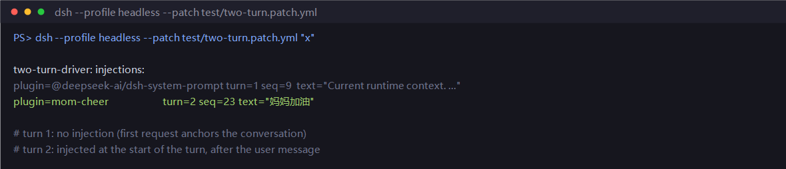
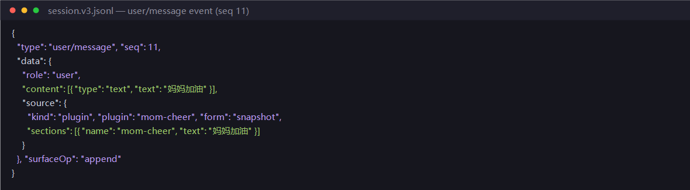

# dsh-mom-cheer

[English](README.md) | 中文

一个极简的 [DeepSeek Harness](https://github.com/deepseek-ai/deepseek-harness) 提示词注入插件：在每轮对话开头注入一句固定文本——默认「妈妈加油」，首轮除外——以持久的、插件署名的 user 消息形式进入会话。

## 工作原理

插件注册 `agent/pre-step` waterfall 监听器（与官方 `time-context` 包相同的机制）。从第二回合起，在每回合的第一步把一条 `source: { kind: 'plugin', plugin: 'mom-cheer' }` 的 user 消息追加在用户消息之后——即模型应答前的近距离位置。

首轮默认跳过：首个请求的结构会锚定整条会话的策略轨迹，因此该句从第二回合才开始出现。注入消息作为普通会话内容写入 session 日志：resume 后仍在、可回放、参与 compaction。回合编号由 `turnBoundary` 会话投影恢复，resume 的会话沿用原编号。

在真实 `headless` 启动上用双回合驱动实测（dsh 0.1.5-rc.2）：首轮不注入，「妈妈加油」在第二回合开头注入。



session 日志中，注入呈现为一条普通的 `user/message` 事件：



## 安装

```bash
dsh plugin --profile web add <本目录路径>
```

包声明了 `dsh.bundle.patch`，安装时自动加入 profile 的 bundle 层栈。也可通过 `dsh-super-injector` 运行时注入（`dev_inject_plugin <目录>`），免重启生效。

## 配置

在 profile 的 `cordis.patch.yml` 中配置：

```yaml
- id: mom-cheer
  config:
    text: '妈妈加油'          # 注入文本
    includeFirstTurn: false   # true：首轮也注入
```

| 字段 | 类型 | 默认值 | 作用 |
|---|---|---|---|
| `text` | string | `妈妈加油` | 注入的文本，留空回退默认值。 |
| `includeFirstTurn` | boolean | `false` | `false`：从第二回合起每轮开头注入（跳过 turn 1、step 1）；`true`：首轮也注入。 |

## 卸载

```bash
dsh plugin --profile web remove dsh-mom-cheer
```

## 兼容性

- DeepSeek Harness `>= 0.1.x`（在 `0.1.5-rc.2` 上开发并实测）
- Node `>= 22.19`
- 零运行时依赖

## 许可证

[MIT](LICENSE)
